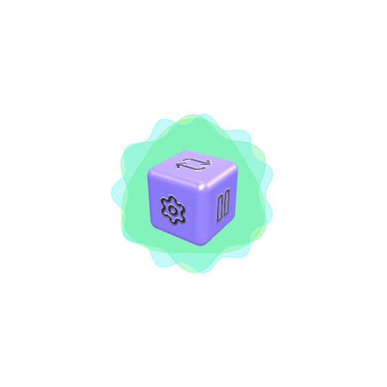
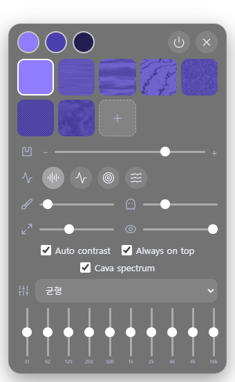

# MusicCube

MusicCube is a tiny music player that floats on the Windows desktop as a borderless, transparent 3D cube, like an icon. Drag it and it turns in any direction. Each of its six faces is a button. While music plays, the sound is drawn around the cube as bars, a wave, rings, an ocean or sand patterns.

<p align="center">
  
  
</p>

The screenshots were captured with a transparent window, so the desktop shows up white.

## Features

- **A cube, not a window.** No frame, no title bar. The window is transparent and the mouse passes through everywhere except the cube itself. The cube sways gently (switchable) and the app remembers where you left it.
- **Six face buttons.** Play/pause, shuffle, repeat (off / all / one), music source, settings, next track.
- **Music from anywhere.** A local folder (all sub-folders), a playlist file (`.m3u`, `.m3u8`, `.pls`), web or YouTube links, or the built-in default YouTube song when nothing is chosen.
- **Five ways to see the sound.** Bars, one closed wave, rings (the SongYUE2 style: each ring shows an earlier moment), an ocean of colour-shifting waves, and cymatics: thousands of grains of sand gather on the nodal lines of a vibrating plate (Chladni patterns). Two plates, one for the bass and one for the treble, are blended by how loud each is, their mode numbers drift all the time so the picture never repeats, a bass hit shakes the sand loose, and the pattern is repeated four ways and changes colour with the radius. Thickness and afterimage are adjustable.
- **A spectrum that looks like the music.** The signal processing of [cava](https://github.com/karlstav/cava) is ported: log-spaced bands, treble compensation, gravity fall-off, smoothing and automatic sensitivity. It can be switched off in the settings.
- **Your own look.** Rounded cube, three colours (background, pattern, icon) with optional auto contrast, seven built-in surface textures plus up to three of your own pictures, an icon relief slider from engraved through flat to embossed, size and opacity.
- **10-band equalizer** for local audio, with the Paradise presets.
- **Settings in their own window.** The settings and the music source open in a separate window that you can move on its own (right-drag).

## Install

No installer. Download `MusicCube-<version>.zip` from the [Releases](https://github.com/madwind0526/MusicCube/releases) page, unzip it anywhere you can write to (not `Program Files`) and run `MusicCube\MusicCube.exe`. The app is **not code-signed**, so Windows SmartScreen may warn you; choose "More info" and then "Run anyway".

Everything the app saves (settings, window position, cache) stays in the `data` folder next to `MusicCube.exe`, so the folder can be copied or deleted as a whole. Nothing is written to `%APPDATA%`.

## Using it

| Action | How |
|---|---|
| Turn the cube | Left-drag on the cube (it keeps spinning a little after you let go) |
| Press a button | Click a face |
| Move the cube | Right-drag on the cube |
| Move the settings window | Right-drag anywhere on it |
| Close the settings window | Its close button, `Esc`, or the same face again |

The six faces:

| Icon | Does |
|---|---|
| Play / Pause | Starts or pauses the music |
| Shuffle | Random order on or off |
| Repeat | Off, all, or one track |
| Folder | Opens the music source window |
| Gear | Opens the settings window |
| Skip | Next track |

### Music source

- **Folder**: every audio file below it plays (`mp3 flac wav ogg oga opus m4a aac webm`, up to 5000 files).
- **Playlist**: an `.m3u`, `.m3u8` or `.pls` file with local paths or web links.
- **URL**: paste YouTube or direct audio links. A list that mixes YouTube links with other entries plays the other entries and skips the YouTube links (the two players cannot be chained); a list of YouTube links alone goes to the YouTube player.
- **Default Song**: goes back to the built-in YouTube song.

### Where the spectrum comes from

| Source | Spectrum |
|---|---|
| Local files | The real audio, analysed with the Web Audio `AnalyserNode` |
| YouTube | The system's audio output, captured by Electron's loopback capture, so it shows what you actually hear. This also picks up other sounds playing on the PC. |
| Web audio links | A beat-shaped stand-in, because that sound cannot be tapped |

The equalizer works on local files only.

## Settings

The settings window has, from the top: the three colour pickers (background, pattern, icon) and the power and close buttons; the texture grid (7 built-in, 3 yours); the relief slider; the five visualizer modes; thickness and afterimage; size and opacity; the check boxes Auto contrast, Always on top, Floating and Cava spectrum; and the equalizer. Hover any icon to see what it is.

Settings are saved in `data\settings.json` next to the exe, and the window position in `data\window.json`. When run from source (`npm run start:dev`, `npm start`) the same files live in `data/` at the project root.

## Development

```bash
npm install
npm run dev          # Vite on http://127.0.0.1:5188 (port is fixed)
npm run start:dev    # Electron against the Vite server (run in a second terminal)
npm run build        # type check + production build into dist/
npm start            # run the built app in Electron
npm test             # unit tests (node --test)
npm run desktop:build   # build + zip of the app folder into release/MusicCube-<version>.zip (unsigned)
```

`start.bat` builds and starts the app (`start.bat dev` runs Vite and Electron together); `stop.bat` stops the Vite port and only MusicCube's own window.

If you launch Electron from a shell that has `ELECTRON_RUN_AS_NODE` set (some agent and CI shells do), unset it first, otherwise Electron starts as plain Node.

### Code map

| Path | What |
|---|---|
| `desktop/main.cjs` | Electron main process: the transparent window, the settings window, folder browsing, the `mcfile://` audio protocol, window position, loopback capture |
| `desktop/preload.cjs` | The `window.api` bridge |
| `desktop/playlist.cjs` | Playlist file and audio-extension rules |
| `src/main.ts` | The cube window: scene, drag rotation, face clicks, loop |
| `src/cube.ts` | The rounded cube, face textures, icon relief |
| `src/textures.ts` | Built-in and user surface textures |
| `src/autocolor.ts` | Auto contrast |
| `src/audio.ts` | Players (local, remote, YouTube), equalizer, system-audio capture |
| `src/spectrum.ts` | The cava signal processing |
| `src/visualizer.ts` | Bars, wave, rings, ocean and cymatics on a 2D canvas behind the cube |
| `src/chladni.ts` | The Chladni plate formula, the sound-to-pattern mapping and the sand simulation |
| `src/popup.ts`, `src/panel.ts`, `panel.html` | The settings and music source window |
| `src/settings.ts` | Settings and how two windows keep them in sync |
| `test/` | Unit tests for the player, playlists, the spectrum and the Chladni sand |
| `scripts/` | Store images: `store-capture.mjs` (transparent captures of the running app) and `store-mockup.py` (composes `store/`) |
| `docs/` | Screenshots |

## Notes and limits

- Windows only so far; it has not been tried on macOS or Linux.
- The app is unsigned and uses the default Electron icon.
- The folder must be writable, because settings are kept inside it.
- The interface text is Korean, except a few labels that were asked for in English (the colour picker tips and the check boxes).
- `codereview.md` holds a code review of an earlier version (in Korean).

## Credits

- [cava](https://github.com/karlstav/cava) by Karl Stavestrand (MIT): the spectrum processing was ported to TypeScript.
- [StellarScript/Cymatics](https://github.com/StellarScript/Cymatics) (MIT): the Chladni plate formula behind the cymatics mode.
- Icons from [Lucide](https://lucide.dev); 3D with [Three.js](https://threejs.org); desktop shell with [Electron](https://www.electronjs.org).
- The look and feel of the music source window, the equalizer presets and the default-song idea follow the author's Paradise project; the ring visualizer follows SongYUE2.
